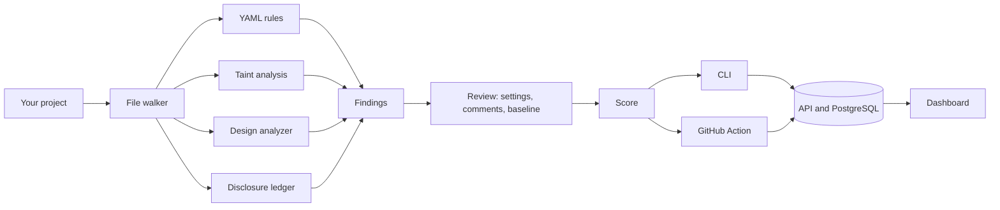

# Shipcheck

Scan a codebase for legal, security and design problems before you ship it.

Shipcheck checks three lists that most projects get wrong:

- **Legal and compliance**: missing policies, consent, unsubscribe links, accessibility basics.
- **Security**: injection, SSRF, path traversal and similar, found by tracing user input through the syntax tree.
- **Design**: the patterns that make an app look machine-generated.

Every finding has a rule id, a location and a suggested fix. The project gets a score from 0 to 100.

## Layout

| Path | What it is |
|---|---|
| `crates/shipcheck-core` | Shared types and scoring |
| `crates/shipcheck-engine` | Rule loading and the scanner |
| `crates/shipcheck-taint` | Taint analysis for JavaScript, TypeScript and Python |
| `crates/shipcheck-design` | Project level design analysis |
| `crates/shipcheck-ledger` | Compares what the code does with what the privacy policy says |
| `crates/shipcheck-cli` | The `shipcheck` command |
| `crates/shipcheck-api` | HTTP API with PostgreSQL storage |
| `rules/` | YAML rule packs |
| `web/` | React and TypeScript dashboard |
| `action/` | GitHub Action that comments on pull requests |

## Quick start

cargo run -p shipcheck-cli -- examples/demo-app

Run the API and the dashboard:
docker compose up -d --wait
cargo run -p shipcheck-api # needs the variables from .env.example
cd web && npm install && npm run dev


More detail lives in `docs/`: rules, taint analysis, design analysis and the API.

## Originality index

Shipcheck measures how much of a project's design is customized rather than left at common framework defaults. The originality index ranges from 0 to 100.

Run the index against your project:

```bash
cargo run -p shipcheck-cli -- . --originality
```

Output the result as JSON:

```bash
cargo run -p shipcheck-cli -- . --originality --format json
```

### What is measured?

| Component | Weight | What it checks |
|---|---:|---|
| Color palette | 50 | Common Tailwind, Bootstrap, and Material default colors |
| Typography | 30 | Frequently used typefaces such as Inter, Roboto, and Poppins |
| Framework tokens | 20 | Default shadcn/ui theme variables |

The weights are distributed across the components that can be evaluated. Components with insufficient data are excluded from the calculation.

### Improving originality

- Customize framework-default colors and build a consistent brand palette.
- Choose typography that fits your product rather than relying on common defaults.
- Customize shadcn/ui theme tokens instead of leaving every value unchanged.

### Originality finding

`DES-301` is a low-severity finding reported when the palette can be evaluated and the originality index is below 40.

### Limitations

The index measures customization, not visual quality. A design using framework defaults can still look excellent. Some colors stored in images, unreadable theme objects, or certain CSS variable formats may not be detected.

See [docs/originality.md](docs/originality.md) for the full methodology.

## Getting started

You need [Rust](https://rustup.rs) (stable). Docker and Node.js are only needed for the API and dashboard.

```bash
git clone https://github.com/eyadstein/shipcheck
cd shipcheck
cargo run -p shipcheck-cli -- examples/demo-app
```

To install the `shipcheck` command:

```bash
cargo install --path crates/shipcheck-cli
```

### Commands

| Command | Purpose |
|---|---|
| `shipcheck <path>` | Scan a project and print findings and score |
| `shipcheck <path> --format json` | Print the report as JSON |
| `shipcheck <path> --fail-under 80` | Exit with code 1 when the score is below 80 |
| `shipcheck <path> --ledger` | Print the disclosure ledger |
| `shipcheck <path> --originality` | Print the originality index |
| `shipcheck <path> --write-baseline FILE` | Accept today's findings as a baseline |
| `shipcheck <path> --baseline FILE` | Hide findings recorded in a baseline |
| `shipcheck . --gym` | Test rules against meaning-preserving variations |

`--rules <dir>` points at a different rule folder. The default is `rules` in the current folder.

## What it checks

The project documents 55 checks across legal and accessibility issues, security, design, and policy drift.

| Area | Rule IDs | How it works |
|---|---|---|
| Legal and accessibility | `LEGAL-001` to `LEGAL-015` | Privacy policies, terms, cookie consent, unsubscribe links, consent defaults, data deletion, age checks, alt text, and focus outlines |
| Security, patterns | `SEC-001` to `SEC-004` | Checks for `eval`, unsafe SQL and shell construction, and `innerHTML` |
| Security, data flow | `SEC-101` to `SEC-109` | Taint analysis for injection, XSS, SSRF, path traversal, unsafe deserialization, open redirects, and template injection |
| Design, patterns | `DES-001` to `DES-003` | Common gradients, fonts, and emoji in headings |
| Design, project level | `DES-201` to `DES-218` | Project-wide visual and copy patterns, including glassmorphism, contrast, spacing, badges, and default themes |
| Design, originality | `DES-301` | Reports a low originality index |
| Policy drift | `DRIFT-001` to `DRIFT-005` | Compares application behavior with privacy-policy statements |

Taint-analysis sources, sanitizers, and sinks are defined in [`catalog.rs`](crates/shipcheck-taint/src/catalog.rs). See [`docs/taint.md`](docs/taint.md).

## Use it in CI

Shipcheck can scan pull requests through its GitHub Action.

```yaml
name: Shipcheck
on:
  pull_request:

permissions:
  contents: read
  pull-requests: write

jobs:
  scan:
    runs-on: ubuntu-latest
    steps:
      - uses: actions/checkout@v4
      - uses: eyadstein/shipcheck/action@main
        with:
          fail-under: "80"
```

The action posts a comment on pull requests and updates it on later pushes. It can also publish the full report in the job summary, upload reports to your API, and fail the job when the score falls below your threshold.

The action builds the scanner from source, so the first run takes a few minutes. See [`docs/action.md`](docs/action.md).

## API and dashboard

Start the local services with Docker Compose:

```bash
docker compose up -d --wait
./scripts/dev.ps1
```

On Windows, `dev.ps1` starts PostgreSQL, the API, and the dashboard. Open [http://localhost:5173](http://localhost:5173) to view projects, score history, and filtered scan findings.

The API is an Axum service backed by PostgreSQL. It computes scores on the server, and write requests require an API key.

| Method | Path | Purpose |
|---|---|---|
| `POST` | `/api/v1/scans` | Store a scan report; requires `x-api-key` |
| `GET` | `/api/v1/scans` | List scans, newest first |
| `GET` | `/api/v1/scans/{id}` | Retrieve one scan and its findings |
| `GET` | `/api/v1/projects` | Get the latest score for every project |
| `GET` | `/health` | Health check |

See [`docs/api.md`](docs/api.md).

## How it fits together



| Path | What it is |
|---|---|
| `crates/shipcheck-core` | Shared types and scoring |
| `crates/shipcheck-engine` | Rule loading, scanning, the rule gym, settings, ignore comments, and baselines |
| `crates/shipcheck-taint` | Taint analysis built on tree-sitter |
| `crates/shipcheck-design` | Project-level design analysis and originality index |
| `crates/shipcheck-ledger` | Disclosure ledger |
| `crates/shipcheck-cli` | The `shipcheck` command |
| `crates/shipcheck-api` | HTTP API with PostgreSQL storage |
| `rules/` | YAML rule packs |
| `web/` | React and TypeScript dashboard |
| `action/` | GitHub Action written in TypeScript |
| `examples/` | Intentionally problematic projects used for tests and documentation |

The scanner is written in Rust, rules are defined in YAML, and the dashboard and Action use TypeScript.

## Writing a rule

Rules describe the category, severity, message, fix, file extensions, matching behavior, and examples.

```yaml
- id: SEC-004
  category: security
  severity: high
  message: innerHTML assignment can lead to cross-site scripting (CWE-79).
  fix: Use textContent, or sanitize the HTML first.
  extensions: [js, ts, jsx, tsx, html]
  match:
    kind: line_regex
    pattern: '\.innerHTML\s*='
  examples:
    flag: ['el.innerHTML = userInput;']
    pass: ['el.textContent = userInput;']
```

Three matcher kinds are supported: `line_regex`, `missing_file`, and `requires_pattern`. Every example is tested, and the rule gym checks how the rule behaves under transformations.

See [`docs/rules.md`](docs/rules.md).

## Rule gym

The rule gym tests whether rules continue to work when examples are rewritten without changing their meaning. Transformations include extra spaces, tabs, quote changes, HTML/CSS capitalization, indentation, line breaks, and trailing comments.

Run the gym:

```bash
cargo run -p shipcheck-cli -- . --gym
cargo run -p shipcheck-cli -- . --gym --fail-under 90
```

The second command fails when the gym score falls below 90.

### Example scan report

The following is an illustrative report, not a guaranteed result for every project.

```text
Shipcheck: 91/100 (Good)

Category    Findings
Legal       2
Security    0
Design      0

2 findings: 1 high, 1 medium.

High LEGAL-001 at (project): No privacy policy file found.
Fix: Add a PRIVACY.md or privacy-policy.html and link it from your footer and sign-up form.

Medium LEGAL-002 at (project): No terms of service file found.
Fix: Add a TERMS.md or terms-of-service.html and link it from your footer.
```

## Disclosure ledger example

The disclosure ledger compares detected application behavior with statements in the privacy policy.

Run it against the included drift demo:

```bash
cargo run -p shipcheck-cli -- examples/drift-demo --ledger
```

Illustrative, abbreviated output:

```text
Third parties (5)
Google Analytics analytics index.html:8 NOT in policy
Hotjar analytics index.html:9 NOT in policy
Sentry monitoring package.json:6 NOT in policy
OpenAI AI package.json:7 NOT in policy
Stripe payments package.json:5 named in policy

Cookies
set at app.js:1 named in policy

Personal data
email addresses index.html:5 NOT in policy
dates of birth index.html:6 NOT in policy
location app.js:2 NOT in policy
```

The ledger can identify mismatches such as code setting cookies when the policy claims cookies are not used. Findings depend on the scanned project.

## Development

Run the Rust formatting, linting, and test checks:

```bash
cargo fmt --all
cargo clippy --workspace --all-targets -- -D warnings
cargo test --workspace
cargo run -p shipcheck-cli -- . --gym --fail-under 90
```

Run the dashboard and Action checks:

```bash
cd web
npm ci
npm run typecheck
npm test

cd ../action
npm ci
npm run typecheck
npm test
```

The API database tests run only when `TEST_DATABASE_URL` is configured. CI also scans the dashboard itself with Shipcheck.

## Limits

- Rules and analyzers are heuristics. They can miss problems and sometimes report harmless code.
- Rules inspect one line at a time, so constructs split across lines can evade pattern checks.
- Taint analysis follows data within one file. It does not follow data across files or through your own functions. It covers JavaScript, TypeScript, and Python.
- The disclosure ledger scans files in the selected project. Code in other repositories is not visible, and Rust sources are not currently read by the ledger.
- The originality index measures the use of common design defaults, not visual quality.
- A clean report does not establish legal compliance. Shipcheck is not legal advice.

## Roadmap

| Milestone | Idea | State |
|---|---|---|
| 7 | Disclosure ledger | Done |
| 8 | Rule gym, baselines, and ignore comments | Done |
| 9 | Originality index | Done |
| 10 | Run the scanner in the browser using WebAssembly | Planned |
| 11 | Fix planner: smallest set of fixes to reach a target score | Planned |
| 12 | Finding history: identify which commit introduced each finding | Planned |
| 13 | Data atlas: draft a privacy policy from the ledger | Planned |

## License

MIT. See [`LICENSE`](LICENSE).
